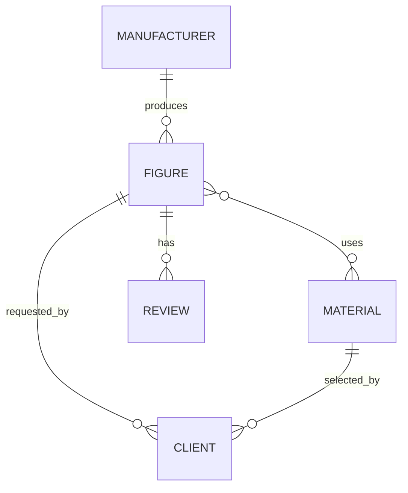

# FigureForge — Collectible Figures Management System

## Django web application | PostgreSQL 

FigureForge is a web application for managing collectible figures, manufacturers, materials, customer orders, and reviews. It provides a browsable catalog and forms for managing related data directly through the website.
---
Table of Contents
* Project Overview
* Technology Stack
* Project Structure
* Database Schema
* Installation
* Environment Variables
* Running the Application
* Web Endpoints
* Filtering, Sorting and Pagination
* Working with an Empty Database
* Validation and Error Handling
  
---

## Project Overview
The project organizes collectible figure information in a relational PostgreSQL database. Each figure belongs to a manufacturer and can be associated with multiple materials. Visitors can browse figures, submit reviews, and create orders using the website's forms.

* Browse collectible figures and their details
* Create, view, update, and delete figures
* Manage manufacturers and materials
* Add, edit, and delete figure reviews
* Create and manage customer orders
* Search and sort catalog records
* Pagination (12 items per list page)
* Form validation and deletion confirmation pages
* Reusable Django templates and custom template functionality
* Custom 404 — Page Not Found page
* PostgreSQL persistence using Django ORM
  
## Technology Stack
- Python
- Django — web framework, templates, forms, ORM, and class-based views
- PostgreSQL — relational database
- HTML / CSS — frontend presentation
- django-decouple / python-decouple — environment-based database configuration (from decouple import config)
- Git and GitHub — version control

---

## Project Structure

```
figureForge/
|
├── common/                 # Homepage and custom 404 view
│   ├── templatetags/
│   ├── urls.py
│   └── views.py
|
├── figures/                # Figure catalog and CRUD
│   ├── forms.py
│   ├── models.py
│   ├── urls.py
│   └── views.py
|
├── manufacturers/          # Manufacturer CRUD
│   ├── forms.py
│   ├── models.py
│   ├── urls.py
│   └── views.py
|
├── materials/              # Material CRUD
│   ├── choices.py
│   ├── forms.py
│   ├── models.py
│   ├── urls.py
│   └── views.py
│
├── reviews/                # Review CRUD
│   ├── forms.py
│   ├── models.py
│   ├── urls.py
│   └── views.py
│
├── user/                   # Customer orders (Client model)
│   ├── choices.py
│   ├── forms.py
│   ├── models.py
│   ├── urls.py
│   └── views.py
│
├── figureForge/            # Project settings and root URL configuration
│   ├── settings.py
│   └── urls.py
├── templates/               # Base, shared and application templates
│   ├── common/
│   ├── figures/
│   ├── manufacturers/
│   ├── materials/
│   ├── reviews/
│   ├── user/
│   ├── shared/
│   ├── 404.html
│   └── base.html
│
├── static/                  # Static assets
│   ├── css/
│   └── images/
│
├── manage.py
├── requirements.txt
├── .env                     # Local only; do not commit
└── README.md
```

---

## Database Schema

The database contains five main application models:
* Manufacturer — name, country
* Material — unique name
* Figure — title, character name, base price, height, unique slug, manufacturer, materials
* Review — author name, rating, comment, creation date, figure
* Client — name, unique email, order status, figure, chosen material, creation date



```
Relationships
Manufacturer (1) ────── (many) Figure
Figure       (many) ─── (many) Material
Figure       (1) ────── (many) Review
Figure       (1) ────── (many) Client
Material     (1) ────── (many) Client
```
---
## Installation

* Clone the repository
```
[git clone https:(https://github.com/dramppet/figureForge.git)
```
* Create a virtual environment:
```
python -m venv .venv
```
* Activate the virtual environment.

* **Windows:
```
.venv\Scripts\activate
```
* **macOS / Linux:
```
source .venv/bin/activate
```
* Install dependencies:
```
pip install -r requirements.txt
```

## Environment Variables

Create a .env file in the project root, alongside manage.py.
```
Example:
DB_NAME=figureforge_db
DB_USER=your_postgres_user
DB_PASSWORD=your_postgres_password
DB_HOST=localhost
DB_PORT=5432
```

The database settings in figureForge/settings.py read these values using python-decouple. Make sure PostgreSQL is running and the database already exists.


## Running the Application

* Start the Django development server:
```  
python manage.py runserver
```
* Open the application in your browser:
```
http://127.0.0.1:8000/
```

## Web Endpoints

### Figure Endpoints

* List all figures:
```
GET /figures/
```
*Create a figure:
```
GET  /figures/add/
POST /figures/add/
```
* View figure details:
```
GET /figures/{id}/
```
* Update a figure:
```
GET  /figures/{id}/update/
POST /figures/{id}/update/
```
* Delete a figure:
```
GET  /figures/{id}/delete/
POST /figures/{id}/delete/
```
The catalog view supports search and sorting through query parameters. For example:
```
/figures/?q=batman
/figures/?sort=base_price
/figures/?sort=-base_price
```
---

### Manufacturer Endpoints

```
GET  /manufacturers/
GET  /manufacturers/add/
POST /manufacturers/add/
GET  /manufacturers/{id}/
GET  /manufacturers/{id}/update/
POST /manufacturers/{id}/update/
GET  /manufacturers/{id}/delete/
POST /manufacturers/{id}/delete/
```
Each manufacturer has a name and country. A manufacturer referenced by a figure is protected from deletion through on_delete=models.PROTECT.

---

### Material Endpoints

```
GET  /materials/
GET  /materials/add/
POST /materials/add/
GET  /materials/{id}/
GET  /materials/{id}/update/
POST /materials/{id}/update/
GET  /materials/{id}/delete/
POST /materials/{id}/delete/
```
Materials are stored as separate database records with unique names. A figure can use multiple materials.

---

### Review Endpoints
```
GET  /reviews/
GET  /reviews/add/
POST /reviews/add/
GET  /reviews/{id}/
GET  /reviews/{id}/edit/
POST /reviews/{id}/edit/
GET  /reviews/{id}/delete/
POST /reviews/{id}/delete/
```
Each review belongs to a figure and contains an author, comment, and rating from 1 to 5. Reviews are ordered by creation date, newest first.

---

### Customer Endpoints
```
GET  /requests/
GET  /requests/add/
POST /requests/add/
GET  /requests/{id}/
GET  /requests/{id}/edit/
POST /requests/{id}/edit/
GET  /requests/{id}/delete/
POST /requests/{id}/delete/
```
A request links a customer name and email to a selected figure and material. The order status defaults to Pending. The user app manages customer requests; it does not implement login or registration.

---

### Home Page & Error Handling

Home page:
```
GET /
```
The home page provides navigation to the catalog and other sections. A custom handler404 renders the project's 404 page for unmatched URLs when Django is running with DEBUG=False and an appropriate host configuration.

---

## Data Validation
Django model fields and forms enforce validation rules, including:
* Figure price must be at least 0.01
* Figure height must be at least 5 cm
* Figure slug must be unique and is generated from the title and character name when missing
* Material name must be unique
* Review rating must be between 1 and 5
* Customer email must be a valid email format and unique
* Customer request status uses predefined choices
  
---

## Architectural Decisions

* Django Class-Based Views are used to implement reusable list, detail, create, update, and delete workflows.
* Django ORM manages database access and model relationships, avoiding manual SQL for normal application operations.
* PostgreSQL is configured as the database backend through environment-based connection settings.
* ModelForms provide form generation and validation based on the Django models.
*Reusable templates keep the interface consistent across different catalog sections.

